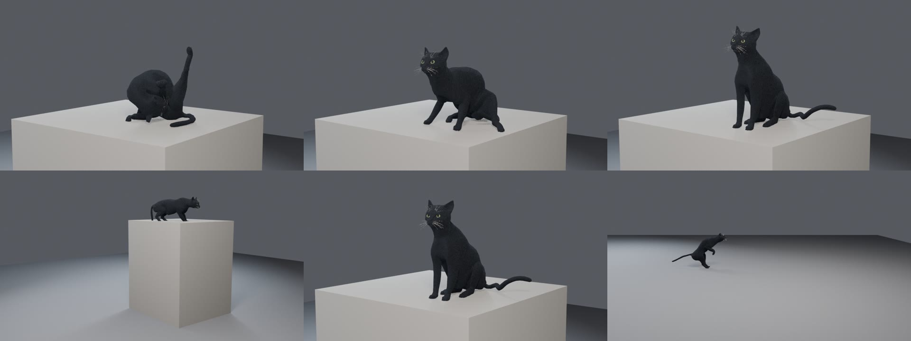

# Black Cat Animation Director Studio v2.1 + Silvestar (`black_cat_director`)

Standalone, general-purpose **Blender 4.x / 5.x Add-on & Python SDK** for animating rigged quadruped black cats with:
1. **180,000-Strand 3D Feline Fur Coat (`PS_Cat_FurCoat`)** — 5,000 combed guide hairs $\times$ 36 interpolated children rendered as 3D `STRIP` strands (`VG_Fur_Density` & `VG_Fur_Length`), paired with a **Matte-Velvet Jet-Black Undercoat**, **Glossy Golden-Green Eye Mask**, and dedicated **Whiskers Shader (`CAT_Whiskers_Mat`)**.
2. **Furless 3D Viewport by Default (`show_viewport = False`, `show_render = True`)** — Viewport playback stays ultra-fast (60–165 FPS) with zero hair particle overhead while animating, and F12 / batch renders automatically display the full 180,000-strand 3D fur coat. Live toggles and length/density sliders are available right in the N-Panel.
3. **Interactive 3D Curve Drawing & Zero-Slip Curve Locomotion** — Draw a 3D Bezier path directly on any surface (`1. Draw Curve Path` -> `2. Finish & Follow`) or generate preset curves (`S-Curve`, `Circle Loop`, `Ledge Jump`). Walking and running animations (`Cat_Walk`, `Cat_ slow Run`, `Cat _Run`, `Cat _Jump`) advance along the curve at their exact biomechanical stride speed (`0.32 m/s`, `0.78 m/s`, `1.35 m/s` scaled by character scale and playback speed) so the cat's paws **never drag or slide**, while stationary animations (`Idle`, `Sit`, `Paw Lick`, `Look Around`, `Meow`, `Sleep`) hold their exact curve position (`0.00 m/s`).
4. **Multi-Clip NLA Animation Stacker, Strip Inspector & Native Blender NLA Editor Sync** — Stack, reorder, duplicate, delete, crossfade, and edit strip repeats (`FILL` auto-stretch to curve length vs `FIXED` repeat counts) directly from the plugin N-Panel, or click **`Open NLA Editor`** to edit strips in Blender's NLA Editor and **`Sync Manual NLA Edits`** to re-solve zero-slip curve locomotion.
5. **Stray-Style Procedural Quadruped Biomechanics (`CAT_Stray_Biomechanics`)** — Non-destructive `COMBINE` NLA layer that bends the cat's spine (`spine_fk`, `chest`, `neck`, `head`) into curve turns with 6–7 frames of head anticipation, counter-steers the tail (`tail_master.001`) as a dynamic rudder, and adds natural feline eyelid blinks (`FP Feline eye closed `), asymmetric ear micro-twitches (`ear.L`, `ear.R`), and chest breathing.

---

## Silvestar Studio (v2.1): mačak iz „Čarobnog lifta” s gotovim animacijama

Silvestar je crni mačak iz imerzivne vožnje **Čarobni lift, Advent u Varaždinu 2026.** U repozitoriju je datoteka
**`silvestar_studio.blend`** (u Gitu kao `silvestar_studio.blend.part01` + `.part02`, instalacija ih sama spoji):

- kolekcija **`SILVESTAR`**: `CTRL_Silvestar` (kontroler, njega pomičeš), `ARM_Silvestar` (Rigify rig, 782 kosti),
  `MESH_Silvestar_Body` (tijelo, brkovi, krzno od 180.000 vlasi samo u renderu), `MESH_Silvestar_Fur`,
- sve finalne animacije iz vožnje kao obične Blender akcije (jedna akcija = jedan klip, ključevi na kontrolama riga),
- 36 ostalih mačjih akcija plugina (hod, trk, spavanje, mijauk …),
- mala studijska scena (kolekcija `SILVESTAR_Scena`: podest, pod, tri svjetla, kamera) i ugrađen plugin.



### Klipovi (u izborniku **Clip** nose oznaku `[SILV]`)

| Akcija | Što radi | Trajanje |
|---|---|---|
| `Cat_Silvestar_Sjedi_Idle_Loop` | sjedi, diše, maše repom; **petlja bez šava** | 285 kadrova (11,9 s) |
| `Cat_Silvestar_Sjedi_Prica_Loop` | sjedi i priča u kameru (glava, čeljust, rep); **petlja** | 287 kadrova (12,0 s) |
| `Cat_Silvestar_Lizanje_Loop` | leži na boku i liže se, tijelo diše; **petlja** | 90 kadrova (3,8 s) |
| `Cat_Silvestar_Lizanje_Sok_Sjedanje` | liže se, trgne se (šok), bulji, žmirne, sjedne | 164 kadra (6,8 s) |
| `Cat_Silvestar_Skok_Na_Podest` | čučne, skoči 1,34 m na podest, okrene se i sjedne | 97 kadrova (4,0 s) |
| `Cat_Silvestar_Poluga` | sjedeći gurne polugu lijevom šapom | 97 kadrova (4,0 s) |
| `Cat_Silvestar_Master_Izvedba` | cijela izvedba iz vožnje: lizanje, šok, sjedanje, govor, poluga | 760 kadrova (31,7 s) |
| `Cat_Silvestar02_Obilazak_Kabine` | drugi mačak: sjedi i gleda, ustane, hoda po podu s jednim skokom (prijeđe 3,1 m) | 476 kadrova (19,8 s) |

Sve je na 24 sličice u sekundi. Petlje se ponavljaju bez skoka (zadnji kadar jednak je prvom, izmjereno 0,000 mm).
Klipovi su izvađeni iz produkcijske scene spajanjem NLA slojeva; položaj kostiju se s izvornikom poklapa unutar 0,4 mm
(`database/silvestar_clips.json`). Kod drugog mačka šape su na tlu unutar 3 mm, a skočni zglob stražnjih nogu odstupa
oko 4 cm jer izvorni rig ima isključeno rastezanje nogu.

Skok je usidren na mjesto sjedenja: mačak kreće 1,34 m niže i 1,03 m ispred kontrolera, a završava točno na njemu,
pa se nakon skoka bez pomaka nastavlja bilo koji sjedeći klip.

### Gotove kombinacije (N-panel → **Black Cat Studio** → „Silvestar: gotove animacije”)

Jedan klik složi kombinaciju u NLA i postavi raspon scene:

| Gumb | ID za skripte | Slijed |
|---|---|---|
| Idle: sjedi, diše, maše repom | `IDLE` | idle petlja × 8 |
| Priča: sjedi i priča | `PRICA` | priča petlja × 6 |
| Idle → priča → idle | `IDLE_PRICA_IDLE` | idle, priča × 2, idle × 3 |
| Lizanje (loop) | `LIZANJE` | lizanje × 10 |
| Lizanje → šok → sjedne → idle | `LIZANJE_SOK_IDLE` | lizanje × 2, šok i sjedanje, idle × 4 |
| Predstava | `PREDSTAVA` | lizanje × 2, šok, priča × 2, idle × 4 |
| Skok na podest → idle | `SKOK_IDLE` | skok, idle × 4 |
| Skok → priča → poluga → gleda | `SKOK_PRICA_POLUGA` | skok, priča, poluga, gleda za liftom |
| Idle → poluga → gleda | `POLUGA` | idle, poluga, gleda za liftom |
| Master izvedba iz vožnje | `MASTER` | cijela izvedba |
| Silvestar 02: obilazak kabine | `S02_OBILAZAK` | sjedi, pa hod i skok po podu (spusti kontroler na pod) |

Nakon toga strip možeš produljiti, usporiti ili presložiti u odjeljku **3. NLA Animation Stacker** ili u Blenderovom
NLA editoru. Isti klipovi rade i na običnom mačku iz gumba **+ Spawn Black Cat** (isti rig).

### Instalacija (ljudi)

Potreban je **Blender 5.0 ili noviji** (datoteka je spremljena iz Blendera 5.3) i Python 3.

```bash
git clone https://github.com/timon2200/black-cat-studio.git
```

```bash
cd black-cat-studio && python3 install_cat_studio.py
```

Zatim otvori `silvestar_studio.blend` i dopusti izvršavanje skripti (Allow Execution) da se pojavi N-panel.
U bilo kojoj drugoj sceni: N-panel → **Black Cat Studio** → **Dodaj Silvestra u scenu**.

### Poruka za tvog AI agenta (kopiraj i zalijepi)

```text
Kloniraj https://github.com/timon2200/black-cat-studio i postavi Silvestra u moj Blender (5.0+):

1. git clone https://github.com/timon2200/black-cat-studio.git && cd black-cat-studio
2. python3 install_cat_studio.py
   (spoji silvestar_studio.blend i knjižnicu iz dijelova .partNN, instalira i uključi add-on black_cat_director)
3. Pročitaj AGENTS.md, odjeljak "Silvestar". Ako imaš živi Blender (MCP execute_blender_code) ili Blender CLI, pokreni:
     import sys; sys.path.insert(0, "<put do black-cat-studio>")
     import black_cat_director as cd
     cd.register()
     ctrl = cd.append_silvestar(location=(0, 0, 0))
     cd.apply_silvestar_preset(ctrl, "IDLE")      # ili PRICA, PREDSTAVA, SKOK_IDLE ...
4. Provjera: Blender -b --factory-startup -P tests/test_silvestar.py  (mora ispisati SVI TESTOVI SILVESTRA PROŠLI)
```

### Python (SDK)

```python
import black_cat_director as cd

ctrl = cd.append_silvestar(location=(0, 0, 0), rotation_z_deg=0)   # kolekcija SILVESTAR + sve akcije
cd.apply_silvestar_preset(ctrl, "IDLE")                            # sjedi, diše, maše repom
cd.apply_silvestar_preset(ctrl, "PREDSTAVA")                       # lizanje -> šok -> priča -> idle

# vlastita kombinacija od istih klipova
cd.set_cat_nla_sequence(ctrl, [
    {"action": "Cat_Silvestar_Sjedi_Idle_Loop",  "repeat": 2, "blend": 0,  "mode": "FIXED"},
    {"action": "Cat_Silvestar_Sjedi_Prica_Loop", "repeat": 1, "blend": 12, "mode": "FIXED"},
    {"action": "Cat_Silvestar_Poluga",           "repeat": 1, "blend": 10, "mode": "FIXED"},
], sync_curve=False)

cd.ensure_silvestar_actions_loaded()        # samo akcije, bez mačka (za vlastitog Black Cat mačka)
cd.list_silvestar_presets()                 # [(id, naziv), ...]
```

Napomene: mačak u mirovanju gleda niz lokalnu os −Y. Govor nije usklađen ni s jednom glasovnom snimkom (čeljust se miče
u nekoliko fraza s pauzama). Pogled u „kameru” iz vožnje zapečen je u klipove priče i master izvedbe.
Krzno se vidi samo u renderu; u viewportu je isključeno radi brzine.

---

## Copy-Paste Prompt for Your AI Agent (Claude Code, Antigravity, Cursor, Windsurf)

Copy and paste the block below to your AI agent to automatically clone, install, and test the plugin in your Blender environment:

```text
Clone https://github.com/timon2200/black-cat-studio.git and set up Black Cat Animation Director Studio v2.0 in my Blender:

1. Clone the repository:
   git clone https://github.com/timon2200/black-cat-studio.git
   cd black-cat-studio

2. Run the universal installer (reassembles database/cat_assets_library.blend from .part01 and .part02, configures portable asset paths, installs and enables the black_cat_director add-on in Blender 4.x/5.x, and builds black_cat_studio.blend):
   python3 install_cat_studio.py

3. Read AGENTS.md in the repository root. If you have a live Blender MCP connection (execute_blender_code) or Blender CLI, load black_cat_director and run cd.integrate_cat_studio(spawn_demo=True) so CTRL_Cat_01 and the "Black Cat Studio" N-Panel appear in my scene.
```

---

## Quick Installation (Humans & Friends)

### Option A — 1-Click Universal Installer (Recommended)
```bash
git clone https://github.com/timon2200/black-cat-studio.git
cd black-cat-studio
python3 install_cat_studio.py
```
Then open **`black_cat_studio.blend`** or open any Blender project and press **`N`** in the 3D Viewport -> **`Black Cat Studio`** tab.

### Option B — Install `.zip` in Blender Preferences
1. Run `python3 install_cat_studio.py --no-scene` (or download `black_cat_director_addon.zip` and `cat_assets_library.blend` from **[GitHub Releases v2.0.0](https://github.com/timon2200/black-cat-studio/releases/tag/v2.0.0)**).
2. In Blender, open **Edit -> Preferences -> Add-ons -> Install from Disk...** and select `black_cat_director_addon.zip`.

---

## N-Panel Workflow (`View3D > Sidebar (N) > Black Cat Studio`)

### 1. Spawn Black Cat & Control 3D Fur Coat
- Click **`+ Spawn Black Cat`** to spawn `CTRL_Cat_01` (`ARM_Cat_01` + `MESH_Cat_01_Body`).
- **Furless Viewport by Default:**
  - **`Viewport Fur: OFF (Fast)`** keeps `PS_Cat_FurCoat.show_viewport = False` so you can scrub and animate at full viewport frame rate. Click it anytime if you want to preview the 3D fur strands in the viewport.
  - **`Render Fur: ON`** keeps `PS_Cat_FurCoat.show_render = True` so F12 / batch renders always render all **180,000 3D hair strands**.
  - Adjust **`Length (mm)`** (default `18.0 mm`) and **`Density`** (default `36` children = `180,000` strands) live.

### 2. Draw a 3D Curve & Make the Cat Follow It (Zero-Slip)
- Click **`1. Draw Curve Path`** — Blender creates `Cat_Path_01`, enters Curve Edit Mode, and activates the interactive **Surface Draw** tool.
- Draw your curve stroke directly in the 3D Viewport.
- Click **`2. Finish & Follow`** (or **`Bind / Sync Cat to Curve`**) — the cat immediately snaps to the curve and bakes zero-slip trajectory keyframes (`PathAnim_CTRL_Cat_01`).
- You can also click **`S-Curve`**, **`Circle Loop`**, or **`Ledge Jump`** to generate preset 3D curves with 1 click.

### 3. Stack & Edit Animations in the NLA Editor
- Pick any of the **29 quadruped animations** from the **`Clip`** dropdown (`Walk Cycle [0.32 m/s]`, `Trot / Slow Run [0.78 m/s]`, `Gallop / Fast Run [1.35 m/s]`, `Jump / Leap Arc [0.85 m/s]`, `Sit Down`, `Stand Up`, `Seated Paw Lick`, `Seated Head Look Around`, `Standing Idle`, `Meow`, `Sleep`, etc.).
- Click **`+ Add to NLA Stack`** or **`Insert @ Playhead`**.
- **In-Panel Strip Stack & Inspector:**
  - Click any strip in the list to jump the playhead to its start and open the **Edit Strip Inspector** (`Action`, `Curve Mode: FILL / FIXED`, `Repeats`, `Speed Mult`, `Blend In`).
  - Toggle **`FILL`** (auto-calculates repeat count so walking clips cover the curve length with `0.00 mm` foot slip) vs **`FIXED`** (plays the exact repeat count while still advancing along the curve at exact stride speed `0.32 m/s` with `0.00 mm` foot slip).
  - Use **`-` / `+`** (`-0.25x` / `+0.25x`), **`Up` / `Down`**, **`Duplicate`**, or **`X`** to edit the stack.
- **Native Blender NLA Editor Integration:**
  - Click **`Open NLA Editor`** to open Blender's native NLA Editor with the cat's tracks focused.
  - After dragging, resizing, or changing repeats manually in Blender's NLA Editor, click **`Sync Manual NLA Edits`** to re-solve the zero-slip curve trajectory automatically.

---

## Python & AI Agent SDK Quick Reference

```python
import sys
sys.path.insert(0, "/path/to/black-cat-studio")
import black_cat_director as cd

# 1. Initialize studio & load database in any .blend file
cd.integrate_cat_studio(spawn_demo=False)

# 2. Spawn a Black Cat actor (Viewport Fur OFF by default, Render Fur ON)
cat = cd.spawn_cat("CTRL_Cat_01", location=(0.0, 0.0, 0.0), viewport_fur=False, render_fur=True)

# 3. Create a custom 3D Bezier curve path
curve = cd.create_cat_curve(
    name="Cat_Path_01",
    points=[(-1.5, 1.2, 0.0), (-0.4, 0.4, 0.0), (0.6, -0.3, 0.0), (1.4, -1.1, 0.0)],
)

# 4. Bind the cat to the curve and stack a multi-clip NLA sequence (Zero-Slip)
cd.bind_cat_to_curve("CTRL_Cat_01", "Cat_Path_01")
cd.set_cat_nla_sequence("CTRL_Cat_01", [
    {"action": "Cat idle (1_143)", "repeat": 0.35, "blend": 0, "mode": "FIXED"},
    {"action": "Cat_Walk (1_32)", "repeat": 1.0, "blend": 6, "mode": "FILL"},
    {"action": "Cat sitting (1-24)", "repeat": 1.0, "blend": 6, "mode": "FIXED"},
    {"action": "Cat_Seated_Paw_Lick (1_104)", "repeat": 1.0, "blend": 8, "mode": "FIXED"},
    {"action": "Cat Standing  (1-24)", "repeat": 1.0, "blend": 6, "mode": "FIXED"},
    {"action": "Cat_Walk (1_32)", "repeat": 1.0, "blend": 6, "mode": "FILL"},
], sync_curve=True)
```
